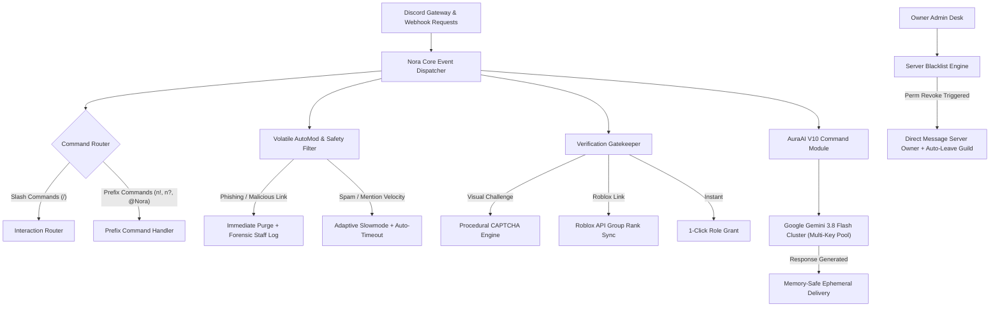

<div align="center">

# ✨ Nora Studio

### **The #1 Privacy-First AI & Next-Gen Moderation Ecosystem for Discord**

<p align="center">
  <a href="https://vaztinix.dev"></a>
  <a href="https://top.gg/user/593420060990005248"></a>
  <a href="https://discord.gg/m9WPYV287q"></a>
  <a href="https://github.com/Vaztinix/nora-studio"></a>
  <a href="#-the-1-top-privacy-bot-choice-for-discord"></a>
  <a href="https://www.botboard.gg/bots/nora?ref=badge"></a>
</p>


</div>

---

## 🌟 What is Nora?

**Nora** is a high-performance, enterprise-grade, privacy-first Discord ecosystem engineered by **Vaztinix** and the **Nora Studio Team**. Our core mission is not only to be the **#1 Privacy-First All-In-One Discord Bot**, but a guardian that **protects every community that she encounters**. Nora brings together next-generation AI conversational intelligence, forensic server security, multi-mode verification, Roblox identity synchronization, interactive community games, and an obsidian-styled real-time Web Dashboard—all built upon an uncompromising **Zero-Access Architecture**.

Nora supports seamless **Dual Command Routing**: run any feature using native Discord Slash Commands (`/`) or universal text chat prefixes (`n!`, `n?`, or `@Nora`).

```
n!help        /verify        n!rank        /setup        n!afk        /starboard
```

---

## 🛡️ The #1 Top Privacy Bot Choice for Discord

Most Discord bots aggressively hoard server logs, scrape private messages for analytics, or sell server statistics to third-party brokers. **Nora was engineered from day one to reject this paradigm.** 

Nora operates strictly under a verified **Zero-Access Privacy Architecture**:

- 🔒 **Zero Permanent Message Storage**: Messages processed for AutoMod, prefixes, and collaborative games are parsed entirely in volatile RAM and immediately discarded. Nora never dumps chat logs or user text to disk.
- 👤 **Total User Sovereignty**: Any user can execute `/mycard` or `n!mycard` to view every piece of metadata associated with their account and click **Erase Data** for an immediate, irreversible wipe.
- 🚫 **Zero Developer Backdoors**: Developers have no administrative backdoors to inspect private channels, read guild logs, or harvest server member data.
- 🔐 **End-to-End Credential Encryption**: Sensitive tokens, webhook URLs, and external credentials are cryptographically protected with **AES-256-GCM** encryption before reaching SQLite storage.
- 💻 **100% Data Custody via Self-Hosting**: When you self-host Nora, you own your database entirely. Zero telemetry is sent home.
- 🛡️ **Automated Safety Filters**: Nora's CI/CD pipeline runs `scripts/safety_filter.js` to ensure zero API keys, webhooks, or tokens ever leak into web builds or public distributions.

---

## 👥 Meet the Nora Studio Team

Behind Nora is **Nora Studio**, a passionate collective of developers, community architects, and security enthusiasts dedicated to building respectful, authentic Discord software:

| Member | Discord Handle | Role & Specialization |
| :--- | :--- | :--- |
| **Vaz** / **Vaztinix** | `vaztinix` (`1214048435632603137`) | **Founder, System Architect & Lead Developer** — Creator of Nora Bot, architect of the AuraAI V10 command engine, web dashboard, and database infrastructure. |
| **strwberry** | `strawberry_angel0000` | **Co-Owner & Community Administrator** — Directs platform partnerships, community guidelines, and feature testing. |
| **TheCasualEnderman** | `charlieisme` | **Lead Contributor & Developer** — Core systems programming, command engine optimization, and feature development. |
| **solorads** | `solorads` | **Team Member & Staff** — Quality assurance, community moderation, and deployment oversight. |
| **discounted_chaos** | `discounted_chaos` | **Team Member & Staff** — Bot operations, feature stress testing, and user feedback coordination. |
| **Mr. Void** | `thevoid_8095` | **Partner** — Official partner of Nora Studio. |
| **boris10106** | `boris10106` | **Team Member & Contributor** — Server integration testing and feature verification. |
| **yunex0** | `yunex0` | **Team Member & Contributor** — Telemetry validation, community support, and bug reporting. |

---

## ⚡ Recent Updates & Key Feature Modules

| Module | Version | Highlights & Capabilities |
| :--- | :---: | :--- |
| **Adaptive Slowmode & Raid Defense** | `v3.1` | Heuristic real-time chat velocity monitoring that automatically clamps slowmode (3s–10s) during floods/raids with smooth decay. Supports channel monitoring filters and exempt role whitelists. |
| **10s AI Fallbacks & Quota Longevity** | `v3.1` | Intelligent model pooling prioritizing lightweight, smart models (`gemini-flash-lite`, `gemini-3.5-flash-lite`) with strict 10s non-blocking fallbacks for Leveling accolades and Starboard spotlight commentary. |
| **Gemini Multi-Model Cluster** | `v3.0` | Multi-key pool load-balancing across project keys, multimodal vision analysis, sticker recognition, and live PC hardware telemetry. |
| **Permanent Server Revoke & Blacklist** | `v3.0` | Comprehensive server blacklist engine in Owner Admin Desk with reason popups, automatic DM delivery to the evicted server owner, and auto-leave logic upon unauthorized re-invites. |
| **4-Tier Verification Suite** | `v2.9` | 4 Server verification engines: 1-Click Instant Button, Anti-Bot Visual CAPTCHA, Reaction Emojis, and Roblox Account Linking with Group Rank synchronization. |
| **Forensic Intelligence & Anti-Raid** | `v2.8` | Automated velocity join detection, account age verification, avatar requirements, phishing signature traps, and 1-click server lockdown. |
| **Starboard Engine v3.0** | `v2.8` | Reaction highlights, threshold triggers, custom star emojis, webhook-rendered author embeds, and **Ignored Channels filter** to protect private channels. |
| **AFK & Availability Manager** | `v2.7` | Status broadcast system, auto `[AFK]` nickname prefixing, anti-ping notifications with automatic cleanup, and return greetings. |
| **Age Suspension & Appeal System** | `v3.0` | Automated age suspension enforcement (`/agesuspension`), forensic sweep utilities, and dedicated automated appeal notification dispatcher. |
| **Leveling & Rank Card Studio** | `v2.8` | Text and voice XP algorithms, milestone role rewards, and rank card studio with live coordinate transforms and custom image uploads. |
| **Collaborative Games** | `v2.6` | Sequential Counting with anti-cheat & XP rewards, plus collaborative One Word Story with milestone archives. |
| **Web Dashboard** | `v3.0` | High-performance obsidian dark dashboard with real-time WebSocket telemetry, unsaved changes guards, and server controls. |

---

## 🛠️ System Architecture



---

## 🚀 Quick Self-Hosting

Nora is fully open-source and easy to self-host. For the complete, detailed step-by-step documentation, see [SELF_HOSTING.md](SELF_HOSTING.md).

### 📋 Prerequisites
- **Node.js** `v18.0.0` or higher ([Node.js Download](https://nodejs.org/))
- **Git**
- **Discord Bot Token** from the [Discord Developer Portal](https://discord.com/developers/applications)

### ⚡ 3-Step Setup
```bash
# 1. Clone the repository
git clone https://github.com/Vaztinix/nora-studio.git
cd nora-studio

# 2. Install dependencies & configure .env
npm install
cp .env.example .env

# 3. Build web dashboard assets & start
npm run build
npm start
```

Access your dashboard locally at `http://localhost:3000`.

---

## 🔗 Official Nora Studio Links

<div align="center">

### **Engineered with passion by Vaztinix & Nora Studio**

| Platform | Official URL |
| :--- | :--- |
| **Official Website** | [https://vaztinix.dev](https://vaztinix.dev) |
| **Nora Team Page** | [https://vaztinix.dev/team](https://vaztinix.dev/team) |
| **Discord Community** | [discord.gg/m9WPYV287q](https://discord.gg/m9WPYV287q) |
| **Developer Profile** | [vaztinix.dev/me](https://vaztinix.dev/me) |
| **GitHub Repository** | [github.com/Vaztinix/nora-studio](https://github.com/Vaztinix/nora-studio) |
| **Top.gg Profile** | [top.gg/user/593420060990005248](https://top.gg/user/593420060990005248) |
| **Contact Email** | [vaztinixstudios@gmail.com](mailto:vaztinixstudios@gmail.com) |

<br>

*Built with curiosity, precision, and an unwavering belief that user privacy must always be absolute.*

</div>
