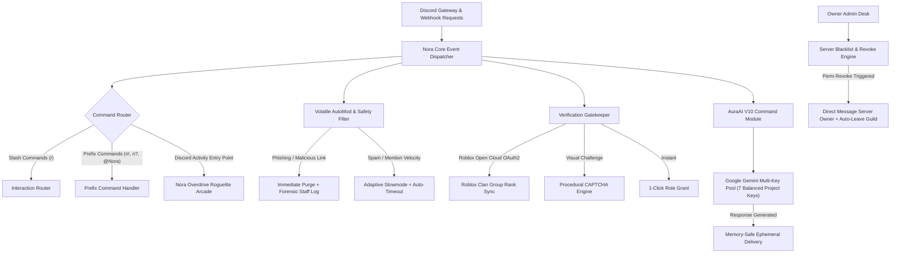

<div align="center">

# ✨ Nora Studio

### **The #1 Privacy-First AI & Next-Gen Moderation Ecosystem for Discord**

<p align="center">
  <a href="https://vaztinix.dev"></a>
  <a href="https://top.gg/user/593420060990005248"></a>
  <a href="https://discord.gg/m9WPYV287q"></a>
  <a href="https://github.com/Vaztinix/nora-studio"></a>
  <a href="#-the-1-top-privacy-bot-choice-for-discord"></a>
  <a href="https://www.botboard.gg/bots/nora?ref=badge"></a>
</p>


</div>

---

## 🌟 What is Nora?

**Nora** is a high-performance, enterprise-grade, privacy-first Discord ecosystem engineered by **Vaztinix** and the **Nora Studio Team**. Our core mission is not only to be the **#1 Privacy-First All-In-One Discord Bot**, but a guardian that **protects every community that she encounters**. Nora brings together next-generation AI conversational intelligence, forensic server security, multi-mode verification, Roblox identity synchronization, interactive community games, an arcade roguelite Discord Activity, and an obsidian crystal **Liquid Glass Web Dashboard**—all built upon an uncompromising **Zero-Access Architecture**.

Nora supports seamless **Dual Command Routing**: run any feature using native Discord Slash Commands (`/`) or universal text chat prefixes (`n!`, `n?`, or `@Nora`).

```
n!help        /verify        n!rank        /setup        n!afk        /starboard
```

---

## 🔒 In-Site Security Pass & Advanced Zero-Trust Verification

For servers requiring maximum community protection (such as Milo's World and Nora's Hub), Nora includes the **In-Site Security Pass**—an enterprise-grade, zero-trust gatekeeper engineered to completely eradicate automated raid attacks, spam bots, and malicious ban evasion networks across all communities:

- 🛡️ **Zero-VPN & Proxy Shield**: Automatically inspects connecting network headers, Tor exit nodes, and datacenter ASN classifications. VPNs and proxy tunnels are strictly barred from receiving verification.
- 🧬 **28-Signal Composite Device Telemetry**: Mathematical anti-aliasing variations, WebGL caps, AudioContext waveform hashes, CPU/RAM hardware tiers, display geometry, system font variations, and regional keyboard maps.
- ⚡ **Automated Alt Correlation & Immediate Ban**: When an account attempts verification, its composite device signature is automatically cross-referenced against server ban records. If an alt belongs to a user banned in the guild, **the alt is automatically and immediately banned**.
- 🔒 **Zero-Trust Ephemeral Tickets**: Verification passes are valid for exactly 15 minutes, uniquely tied to the originating Discord session to prevent link sharing.
- 🎨 **Full Dashboard Customization**: Dedicated In-Site Gatekeeper dashboard suite to customize embed titles, descriptions, button labels, emojis, and toggle help explanations with unified redirects for all communities.
- 👤 **Human Non-Inspection Architecture**: Developers and staff possess zero tools to view private personal files or raw biometrics. All attributes are processed purely as mathematical cryptographic checksums in volatile RAM.

---

## 🟢 Privileged Presence Intent: Fully Approved & Active

Nora has officially received approval for the Discord **Guild Presences Intent** (`GatewayIntentBits.GuildPresences`). All presence-dependent features are now fully functional across all servers:

- 🌟 **Promoter Custom Status Detection**: Automatically detect community members sporting vanity invite URLs or server hashtags in their Discord custom status, instantly granting designated promoter roles.
- 🎮 **Dynamic Activity & Gaming Voice Routing**: Intelligent voice channel sorting and routing based on members' live games and rich presence activities.
- 📊 **Real-Time Guild Statistics**: Live count of online, idle, and in-game members displayed in the Nora Studio dashboard and bot status commands.

---

## 🛡️ The #1 Top Privacy Bot Choice for Discord

Most Discord bots aggressively hoard server logs, scrape private messages for analytics, or sell server statistics to third-party brokers. **Nora was engineered from day one to reject this paradigm.** 

Nora operates strictly under a verified **Zero-Access Privacy Architecture**:

- 🔒 **Zero Permanent Message Storage**: Messages processed for AutoMod, prefixes, and collaborative games are parsed entirely in volatile RAM and immediately discarded. Nora never dumps chat logs or user text to disk.
- 🚫 **Zero IP Address or Location Surveillance**: Nora strips all IP and geolocation tracking, rejects third-party GeoIP lookups, and never records your physical network location.
- 👤 **"My Data" Total User Sovereignty**: Any user can execute `/mycard` or open the Dashboard **My Data** desk to inspect every single record across servers and execute a 1-click irreversible data purge (`Purge Everything Globally`).
- 🚫 **Zero Developer Backdoors**: Developers have no administrative backdoors to inspect private channels, read guild logs, or harvest server member data.
- 🔐 **End-to-End Credential Encryption**: Sensitive tokens, webhook URLs, and external credentials are cryptographically protected with **AES-256-GCM** encryption before reaching SQLite storage.
- 💻 **100% Data Custody via Self-Hosting**: When you self-host Nora, you own your database entirely. Zero telemetry is sent home.
- 🛡️ **Automated Safety Filters**: Nora's CI/CD pipeline runs `scripts/safety_filter.js` to ensure zero API keys, webhooks, or tokens ever leak into web builds or public distributions.

---

## 👥 Meet the Nora Studio Team

Behind Nora is **Nora Studio**, a passionate collective of developers, community architects, and security enthusiasts dedicated to building respectful, authentic Discord software:

| Member | Discord Handle | Role & Specialization |
| :--- | :--- | :--- |
| **Vaz** / **Vaztinix** | `vaztinix` (`1214048435632603137`) | **Founder, System Architect & Lead Developer** — Creator of Nora Bot, architect of the AuraAI V10 command engine, web dashboard, and database infrastructure. |
| **strwberry** | `strawberry_angel0000` | **Co-Owner & Community Administrator** — Directs platform partnerships, community guidelines, and feature testing. |
| **TheCasualEnderman** | `charlieisme` | **Lead Contributor & Developer** — Core systems programming, command engine optimization, and feature development. |
| **solorads** | `solorads` | **Team Member & Staff** — Quality assurance, community moderation, and deployment oversight. |
| **discounted_chaos** | `discounted_chaos` | **Team Member & Staff** — Bot operations, feature stress testing, and user feedback coordination. |
| **Mr. Void** | `thevoid_8095` | **Partner** — Official partner of Nora Studio. |
| **boris10106** | `boris10106` | **Team Member & Contributor** — Server integration testing and feature verification. |
| **yunex0** | `yunex0` | **Team Member & Contributor** — Telemetry validation, community support, and bug reporting. |

---

## ⚡ Recent Updates & Key Feature Modules (Version 4.0 Release)

| Module | Version | Highlights & Capabilities |
| :--- | :---: | :--- |
| **In-Site Security Pass & Zero-Trust Verification** | `v4.2` | Advanced high-security gatekeeper evaluating 28 composite hardware, software & network signals. Automatically rejects VPNs/proxies, correlates alts against server ban registries to automatically ban evaders, and provides fully customizable Embeds V2 presets with unified community redirects. |
| **Wick-Style Anti-Nuke Staff Quarantine** | `v4.3` | Protects servers against rogue moderators or compromised staff accounts by monitoring destructive action velocity (mass channel/role deletion, mass ban/kick within 15s). Automatically strips dangerous admin permissions, assigns a Quarantine containment role, applies a 1-hour timeout, logs an audit case, and dispatches urgent DM alerts to the Server Owner. |
| **Weekly Vote Rewards & User Consumable Inventory** | `v4.3` | 7-day progressive vote streak game on Top.gg awarding XP vouchers, free AI credits, My TV entertainment passes, and 3-Day Nora Premium passes. Includes personal consumable Inventory desk with single-server redemption picker and upcoming perk trading preparation. |
| **Interactive Party Games: Word Bomb & Trivia Quiz** | `v4.3` | Built-in interactive party games (`/wordbomb` & `/trivia`) for text and voice hangout channels with syllable countdown timers, Discord button selection, multi-category question banks, and leveling XP rewards. |
| **Next-Gen AutoMod & Strict Threat Defense** | `v4.3` | Dedicated hate speech prevention, zero-tolerance slur interception, exact-word-boundary profanity filtering (zero false positives on ordinary words), independent Mass Caps Shouting and Zalgo Unicode toggles, and stream self-promotion filters. |
| **Support Ticketing Analytics & Historical Export** | `v4.3` | Recent Activity chart with line grid markers and touch/hover volume tooltips, plus 1-click comprehensive server ticket history JSON export. |
| **Crystal Liquid Glass Design System** | `v4.0` | Ultra-modern frosted glass aesthetic with specular rim reflections, dynamic ambient aurora refractions, and fluid micro-animations across the Dashboard, Nora Sentinel, Roblox Verification, and Profile. |
| **Server Icon Ambient Palette Extraction** | `v4.0` | Dynamically samples each server icon's dominant color palette via an offscreen HTML canvas, casting authentic 3-color ambient glow halos behind server cards without arbitrary color hashing. |
| **Automatic Background Readability Engine** | `v4.0` | Real-time luminance and contrast sampling calculating optimal background opacity (25%–35%) and blur (10px–16px) with instant slider retention and local cache persistence. |
| **Per-Server Rank Card Studio** | `v4.0` | Choose whether your custom rank card applies across all servers or select specific servers to design individual themes, with live interactive coordinate preview. |
| **My Data — Zero-Access Sovereignty & Personal Inspector** | `v4.2` | Completely overhauled user sovereignty modal ("My Data") allowing members to inspect 100% of tracked data with zero `undefined` values, export full JSON data packs, or execute 1-click global data purges. |
| **Early Adopter Lifetime Nora Premium** | `v4.2` | Permanently granted Nora Premium to the first 100 registered users and first 50 joined servers. |
| **High-Speed Roblox Verification Portal** | `v4.0` | Parallel concurrent fetching (`Promise.allSettled`), instant cache hydration (0ms render), and Roblox Open Cloud OAuth2 group rank synchronization. |
| **Nora Overdrive Arcade Roguelite (Discord Activity)** | `v4.0` | Full Discord Activity integration with Activity Entry Point command support, 110+ procedural power-ups across 8 rarities, automatic persistent high scores, multi-device touch/gamepad/keyboard handling, and growing boss encounters. |
| **Adaptive Slowmode & Raid Defense** | `v3.1` | Heuristic real-time chat velocity monitoring that automatically clamps slowmode (3s–10s) during floods/raids with smooth decay. Supports channel monitoring filters and exempt role whitelists. |
| **Gemini Multi-Model Balancing** | `v3.1` | Multi-key pool load-balancing across 7 distinct Gemini project keys with automatic fallback to lightweight models (`gemini-flash-lite`, `gemini-3.5-flash-lite`) and strict non-blocking fallbacks. |
| **Permanent Server Revoke & Blacklist** | `v3.0` | Comprehensive server blacklist engine in Owner Admin Desk with reason popups, automatic DM delivery to the evicted server owner, and auto-leave logic upon unauthorized re-invites. |
| **4-Tier Verification Suite** | `v2.9` | 4 Server verification engines: 1-Click Instant Button, Anti-Bot Visual CAPTCHA, Reaction Emojis, and Roblox Account Linking with Group Rank synchronization. |
| **Forensic Intelligence & Anti-Raid** | `v2.8` | Automated velocity join detection, account age verification, avatar requirements, phishing signature traps, and 1-click server lockdown. |
| **Starboard Engine v3.0** | `v2.8` | Reaction highlights, threshold triggers, custom star emojis, webhook-rendered author embeds, and **Ignored Channels filter** to protect private channels. |
| **AFK & Availability Manager** | `v2.7` | Status broadcast system, auto `[AFK]` nickname prefixing, anti-ping notifications with automatic cleanup, and return greetings. |
| **Collaborative Games** | `v2.6` | Sequential Counting with anti-cheat & XP rewards, plus collaborative One Word Story with milestone archives. |

---

## 🛠️ System Architecture



---

## 🚀 Quick Self-Hosting

Nora is fully open-source and easy to self-host. For the complete, detailed step-by-step documentation, see [SELF_HOSTING.md](SELF_HOSTING.md).

### 📋 Prerequisites
- **Node.js** `v18.0.0` or higher ([Node.js Download](https://nodejs.org/))
- **Git**
- **Discord Bot Token** from the [Discord Developer Portal](https://discord.com/developers/applications)

### ⚡ 3-Step Setup
```bash
# 1. Clone the repository
git clone https://github.com/Vaztinix/nora-studio.git
cd nora-studio

# 2. Install dependencies & configure .env
npm install
cp .env.example .env

# 3. Build web dashboard assets & start
npm run build
npm start
```

Access your dashboard locally at `http://localhost:3000`.

---

## 🔗 Official Nora Studio Links

<div align="center">

### **Engineered with passion by Vaztinix & Nora Studio**

| Platform | Official URL |
| :--- | :--- |
| **Official Website** | [https://vaztinix.dev](https://vaztinix.dev) |
| **Web Dashboard** | [https://vaztinix.dev/dashboard](https://vaztinix.dev/dashboard) |
| **Verification Portal** | [https://vaztinix.dev/verify](https://vaztinix.dev/verify) |
| **System Status** | [https://vaztinix.dev/status](https://vaztinix.dev/status) |
| **Official Discord Community** | [https://discord.gg/m9WPYV287q](https://discord.gg/m9WPYV287q) |
| **Discord Bot Invite** | [Add Nora to Discord](https://discord.com/oauth2/authorize?client_id=1375943730951098549&permissions=8&integration_type=0&scope=bot+applications.commands) |
| **Top.gg Page** | [https://top.gg/user/593420060990005248](https://top.gg/user/593420060990005248) |
| **Developer Portfolio** | [https://vaztinix.dev](https://vaztinix.dev) |

</div>
